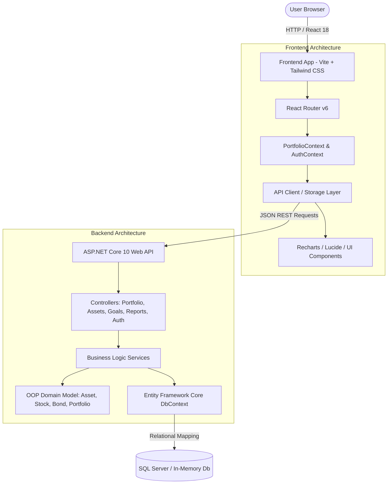

# WealthWise - Wealth Management & Investment Portal

[](https://dotnet.microsoft.com/)
[](https://react.dev/)
[](https://www.typescriptlang.org/)
[](https://tailwindcss.com/)
[](https://learn.microsoft.com/ef/core/)
[](file:///e:/anitgravity/wealth_creation/backend/WealthWise.Tests)

**WealthWise** is a modern, responsive, full-stack wealth management and multi-asset investment portal designed for the Indian financial ecosystem. It enables individual investors and wealth managers to track diverse asset classes (Equities, Sovereign and Corporate Bonds, Mutual Funds, ETFs, and Cash reserves), analyze real-time market movements, plan long-term financial goals, execute simulated buy/sell orders, calculate bond yields, and generate financial reports.

---

## Table of Contents
1. [Key Features](#key-features)
2. [Architecture & Tech Stack](#architecture--tech-stack)
3. [Demonstration of C# OOP Principles](#demonstration-of-c-oop-principles)
4. [Project Structure](#project-structure)
5. [Quick Start Guide](#quick-start-guide)
   - [Starting the Frontend](#1-starting-the-frontend)
   - [Starting the Backend API](#2-starting-the-backend-api)
   - [Running the Unit Test Suite](#3-running-the-unit-test-suite)
6. [SQL Server Configuration](#sql-server-configuration)
7. [External Market API Integration Guide](#external-market-api-integration-guide)
8. [API Endpoints Reference](#api-endpoints-reference)
9. [Financial Calculation Formulas](#financial-calculation-formulas)
10. [Regulatory & Educational Disclaimer](#regulatory--educational-disclaimer)

---

## Key Features

- **Comprehensive Dashboard**:
  - Four top-level metric stat cards with period-over-period percentage changes: Total Portfolio Value, Total Invested, Overall Unrealized Gain/Loss, and Available Cash.
  - Interactive multi-timeframe portfolio performance line chart (**1W, 1M, 3M, 6M, 1Y, ALL**) built with Recharts.
  - Interactive asset allocation donut chart with segment hover inspection and quick percentage breakdown.
  - Quick action modal triggers: Buy/Add Asset, Record Transaction, Add Financial Goal, Bond Yield Calculator.
  - Real-time market status indicator showing IST market hours (9:15 AM - 3:30 PM IST).
- **Multi-Asset Portfolio Tracker**:
  - Full support for Indian Equities (TCS, INFY, RELIANCE, HDFCBANK, ITC, NTPC, IRFC), Sovereign & Corporate Bonds (GOI-7.18-2033, REC-7.54-2028), Mutual Funds (Parag Parikh Flexi Cap, SBI Bluechip), and ETFs (NIFTYBEES, GOLDBEES).
  - Categorized holdings table with ticker badges, purchase dates, average buy price, current market price, daily change, unrealized profit/loss, and portfolio weighting.
  - Asset class filter tabs (`All`, `Stocks`, `Bonds`, `Mutual Funds`, `ETFs`) and instant search filtering.
  - Direct Buy More and Sell modal dialogs preventing overselling.
- **Dedicated Asset Class Portals**:
  - **Stocks**: Top gainers/losers, NIFTY 50 / SENSEX index tracking cards, sector allocation metrics, and quick quote search.
  - **Bonds**: Face value, coupon rates, semi-annual payment schedules, maturity dates, and built-in interactive Yield-to-Maturity & Semi-Annual Coupon Calculator.
  - **Mutual Funds**: NAV tracking, fund category tags, expense ratios, risk ratings, and SIP investment shortcuts.
  - **ETFs**: Expense ratios, tracking errors, underlying index benchmarks, and real-time market bid/ask spreads.
- **Transaction Engine & History**:
  - Filterable audit trail of all `BUY`, `SELL`, `DIVIDEND`, `DEPOSIT`, and `WITHDRAWAL` transactions with auto-calculated total settlement amounts.
  - Export transaction history to CSV format for accounting and tax reporting.
- **Financial Goal Planner**:
  - Track financial milestones (Emergency Fund, House Down Payment, Retirement, Higher Education, Wealth Creation).
  - Target amount, target maturity date, linked assets, and dynamic progress bar.
  - Smart monthly SIP/savings recommender calculating the monthly contribution required to reach the target on schedule based on compounding growth assumptions.
- **Watchlist & Market Monitoring**:
  - Add and remove securities to a personal watchlist with 24h price changes, 52-week high/low progress bars, and one-click buy actions.
- **Analytics & Tax Reports**:
  - Capital Gains estimation (Short-Term Capital Gains STCG @ 20% / Long-Term Capital Gains LTCG @ 12.5% per Indian budget guidelines).
  - Asset class diversification breakdown and monthly transaction volume bar charts.
  - Print-ready and exportable portfolio summary statement.
- **Indian Numbering Format & Theme Support**:
  - Formats all currency in Indian numbering syntax (`₹2,45,680.50`, compact `₹1.25 Cr` / `₹45.2 Lakhs`).
  - Dark Mode and Light Mode with system-preference detection and persistence.
- **Dual Persistence Architecture**:
  - Connects seamlessly to the ASP.NET Core REST API backed by SQL Server or In-Memory database.
  - Gracefully falls back to browser `localStorage` when offline or running in standalone frontend mode.

---

## Architecture & Tech Stack



### Technology Matrix
| Layer | Technologies | Key Packages |
|---|---|---|
| **Frontend** | React 18, Vite, TypeScript | `react-router-dom`, `lucide-react`, `recharts`, `tailwindcss`, `clsx`, `tailwind-merge` |
| **Backend** | C# 10 / ASP.NET Core 10 Web API | `Microsoft.EntityFrameworkCore`, `Microsoft.EntityFrameworkCore.SqlServer`, `Microsoft.EntityFrameworkCore.InMemory`, `Swashbuckle.AspNetCore` |
| **Testing** | xUnit, .NET Test SDK | `xunit`, `xunit.runner.visualstudio`, `Microsoft.NET.Test.Sdk` |
| **Styling** | Tailwind CSS v3 | Custom dark mode palette, fintech badge styling, responsive grid layouts |

---

## Demonstration of C# OOP Principles

The project was constructed specifically to demonstrate advanced Object-Oriented Programming (OOP) design patterns in C#. All domain models reside in `backend/WealthWise.API/Models/Domain/`.

### 1. Abstract Base Class & Polymorphism
The base class `Asset` declares an abstract method `CalculateReturn(decimal currentPrice)`, which is overridden with specialized logic by each derived asset type:

- [`Asset.cs`](file:///e:/anitgravity/wealth_creation/backend/WealthWise.API/Models/Domain/Asset.cs#L6-L23):
  ```csharp
  public abstract class Asset
  {
      public int Id { get; set; }
      public string Ticker { get; set; } = string.Empty;
      public string Name { get; set; } = string.Empty;
      public AssetType Type { get; set; }
      public decimal PurchasePrice { get; set; }
      public DateTime PurchaseDate { get; set; }

      // Pure virtual method overridden polymorphically
      public abstract decimal CalculateReturn(decimal currentPrice);
  }
  ```

- [`Stock.cs`](file:///e:/anitgravity/wealth_creation/backend/WealthWise.API/Models/Domain/Stock.cs#L5-L21):
  ```csharp
  public class Stock : Asset
  {
      public string Exchange { get; set; } = "NSE";
      public string Sector { get; set; } = string.Empty;
      public decimal DividendYield { get; set; }

      public override decimal CalculateReturn(decimal currentPrice)
      {
          if (PurchasePrice <= 0) return 0m;
          return ((currentPrice - PurchasePrice) / PurchasePrice) * 100m;
      }
  }
  ```

- [`Bond.cs`](file:///e:/anitgravity/wealth_creation/backend/WealthWise.API/Models/Domain/Bond.cs#L5-L26):
  ```csharp
  public class Bond : Asset
  {
      public decimal CouponRate { get; set; }
      public decimal FaceValue { get; set; }
      public DateTime MaturityDate { get; set; }
      public string Frequency { get; set; } = "Semi-Annual";

      public override decimal CalculateReturn(decimal currentPrice)
      {
          // Total return incorporates capital appreciation and annual coupon payment
          decimal capitalGain = currentPrice - PurchasePrice;
          decimal annualCoupon = FaceValue * (CouponRate / 100m);
          return PurchasePrice > 0 ? ((capitalGain + annualCoupon) / PurchasePrice) * 100m : 0m;
      }
  }
  ```

### 2. C# Indexer Implementation
The [`Portfolio.cs`](file:///e:/anitgravity/wealth_creation/backend/WealthWise.API/Models/Domain/Portfolio.cs#L22-L34) class implements a custom C# indexer allowing O(1) lookup of holdings by ticker symbol (`portfolio["TCS"]`):

```csharp
public class Portfolio
{
    private readonly Dictionary<string, Investment> _investmentLookup = new(StringComparer.OrdinalIgnoreCase);

    // C# Indexer for intuitive, dictionary-backed ticker lookup
    public Investment? this[string ticker]
    {
        get
        {
            if (string.IsNullOrWhiteSpace(ticker)) return null;
            return _investmentLookup.TryGetValue(ticker, out var inv) ? inv : null;
        }
    }

    public void AddInvestment(Investment investment)
    {
        _investments.Add(investment);
        _investmentLookup[investment.Asset.Ticker] = investment;
    }
}
```

### 3. Iteration over Generic Collections (`List<T>` with `foreach`)
Portfolio valuation, asset allocation weights, and portfolio gains are computed by iterating over strongly-typed generic collections:

```csharp
public decimal CalculateTotalPortfolioValue()
{
    decimal total = CashBalance;
    foreach (var inv in _investments)
    {
        total += inv.CalculateCurrentValue();
    }
    return total;
}
```

### 4. Encapsulation & Domain Invariants
- Private backing fields and validated mutators protect internal state.
- Cash balance withdrawal validation prevents account overdrawing:
  ```csharp
  public void DeductCash(decimal amount)
  {
      if (amount <= 0) throw new ArgumentException("Amount must be positive.", nameof(amount));
      if (amount > CashBalance) throw new InvalidOperationException($"Insufficient cash. Available: ₹{CashBalance:N2}, Requested: ₹{amount:N2}");
      CashBalance -= amount;
  }
  ```
- Holding reduction validation prevents selling more shares than currently owned:
  ```csharp
  public void SellShares(int quantityToSell)
  {
      if (quantityToSell <= 0) throw new ArgumentException("Quantity must be greater than zero.");
      if (quantityToSell > Quantity) throw new InvalidOperationException($"Cannot sell {quantityToSell} shares. Only {Quantity} shares available.");
      Quantity -= quantityToSell;
  }
  ```

### 5. High-Precision Financial Calculations
All monetary amounts, asset prices, coupon yields, tax estimations, and balance updates use the .NET `decimal` primitive (128-bit IEEE 754 decimal floating point) and SQL `decimal(18,2)` to eliminate binary rounding errors. Share quantities strictly utilize `int`.

---

## Project Structure

```
wealth_creation/
├── README.md                                # Root documentation
├── backend/
│   ├── WealthWise.API/                      # ASP.NET Core 10 Web API
│   │   ├── Controllers/
│   │   │   ├── AuthController.cs            # Login, register, demo user
│   │   │   ├── DashboardController.cs       # Portfolio summary, charts, allocations
│   │   │   ├── PortfolioController.cs       # Investments CRUD & cash balance management
│   │   │   ├── AssetsController.cs          # Asset catalog, quotes, bond calculator
│   │   │   ├── TransactionsController.cs    # Transaction log, Buy/Sell execution
│   │   │   ├── GoalsController.cs           # Financial goals planner CRUD
│   │   │   ├── ReportsController.cs         # Performance & tax reports
│   │   │   └── WatchlistController.cs       # Watchlist items
│   │   ├── Data/
│   │   │   ├── WealthWiseDbContext.cs       # EF Core context with TPH inheritance
│   │   │   └── DbInitializer.cs             # Automatic database seeder
│   │   ├── DTOs/                            # Data Transfer Objects
│   │   ├── Middleware/
│   │   │   └── ExceptionHandlingMiddleware.cs
│   │   ├── Models/
│   │   │   ├── Common/ApiResponse.cs        # Unified response envelope
│   │   │   └── Domain/
│   │   │       ├── Asset.cs                 # Abstract base class
│   │   │       ├── Stock.cs                 # Derived Stock class
│   │   │       ├── Bond.cs                  # Derived Bond class
│   │   │       ├── MutualFund.cs            # Derived Mutual Fund class
│   │   │       ├── ETF.cs                   # Derived ETF class
│   │   │       ├── Investment.cs            # Holding model with validation
│   │   │       ├── Portfolio.cs             # Aggregate root with C# indexer
│   │   │       ├── Transaction.cs           # Transaction audit log
│   │   │       ├── FinancialGoal.cs         # Goal model
│   │   │       ├── WatchlistItem.cs         # Watchlist entry
│   │   │       └── User.cs                  # User entity
│   │   ├── Services/                        # Business logic interfaces & implementations
│   │   ├── appsettings.json                 # Connection strings & configuration
│   │   └── Program.cs                       # Web API entry point, DI, CORS, Swagger
│   └── WealthWise.Tests/                    # xUnit Test Project
│       ├── DomainCalculationTests.cs        # OOP polymorphism & indexer tests
│       └── WealthWise.Tests.csproj
└── frontend/                                # React 18 + Vite + TypeScript Frontend
    ├── index.html
    ├── vite.config.ts
    ├── tailwind.config.js
    ├── tsconfig.json
    ├── .env                                 # VITE_API_URL=http://localhost:5000/api
    └── src/
        ├── App.tsx                          # App router & context providers
        ├── components/
        │   ├── bonds/BondCalculatorModal.tsx # Interactive Bond Yield calculator
        │   ├── charts/                      # Recharts line, donut & bar charts
        │   ├── common/                      # StatCard, Modal, Toast, Skeleton, EmptyState
        │   ├── goals/GoalModal.tsx          # Goal creation & edit modal
        │   ├── layout/                      # Sidebar (12 nav items), Topbar, DashboardLayout
        │   ├── portfolio/                   # HoldingsTable, InvestmentModal
        │   └── transactions/TransactionModal.tsx # Buy/Sell transaction execution modal
        ├── context/
        │   ├── AuthContext.tsx              # Demo user authentication state
        │   ├── PortfolioContext.tsx         # Unified portfolio reactive state
        │   └── ThemeContext.tsx             # Dark/Light theme toggle
        ├── data/
        │   ├── sampleAssets.ts              # Market catalogue (Equities, Bonds, MFs, ETFs)
        │   └── sampleData.ts                # Default Section 19 seed portfolio
        ├── pages/                           # 15 Complete Page Views (no placeholders)
        │   ├── DashboardPage.tsx            # Main overview
        │   ├── PortfolioPage.tsx            # Holdings table & asset filters
        │   ├── StocksPage.tsx               # Stock market view
        │   ├── BondsPage.tsx                # Bonds view + calculator button
        │   ├── MutualFundsPage.tsx          # Mutual fund tracker
        │   ├── ETFsPage.tsx                 # ETF tracker
        │   ├── TransactionsPage.tsx         # Transaction log & CSV export
        │   ├── WatchlistPage.tsx            # Personalized watchlist
        │   ├── GoalsPage.tsx                # Financial goal planner
        │   ├── ReportsPage.tsx              # Tax & capital gains reports
        │   ├── SettingsPage.tsx             # User preferences & currency
        │   └── auth/                        # Login, Register, Forgot/Reset Password
        ├── services/
        │   ├── api.ts                       # REST API client with offline fallback
        │   └── storage.ts                   # LocalStorage persistence engine
        ├── types/index.ts                   # TypeScript interfaces matching backend DTOs
        └── utils/
            ├── calculations.ts              # Return formulas & SIP savings calculator
            └── formatters.ts                # Indian currency (Lakhs/Crores) & date formatters
```

---

## Quick Start Guide

### Prerequisites
- **.NET 10.0 SDK** (or .NET 8.0/9.0) installed ([Download .NET](https://dotnet.microsoft.com/download))
- **Node.js v18+** and `npm` installed ([Download Node](https://nodejs.org/))

---

### 1. Starting the Frontend
The frontend is pre-configured with a Vite development server and auto-reloading:

```bash
# Navigate to the frontend directory
cd frontend

# Install dependencies (already installed)
npm install

# Start Vite development server
npm run dev
```

The application will be accessible at:
👉 **`http://localhost:5173`**

> **Tip**: WealthWise includes a full offline mock service in `frontend/src/services/api.ts`. If the backend API is not running, the application will automatically persist your changes to browser `localStorage` and provide a seamless experience!

---

### 2. Starting the Backend API
The backend is an ASP.NET Core Web API with automated database migrations and sample data seeding:

```bash
# Navigate to the API directory
cd backend/WealthWise.API

# Run the API server
dotnet run
```

The API will start and listen on:
- API Base URL: **`http://localhost:5000`**
- Swagger Interactive Documentation: **`http://localhost:5000/swagger`**

---

### 3. Running the Unit Test Suite
The unit test suite verifies all polymorphism rules, indexer lookups, cash deduction validations, and sell quantity restrictions:

```bash
# Navigate to the test project directory
cd backend/WealthWise.Tests

# Execute tests
dotnet test
```

Expected output:
```
Passed! - Failed: 0, Passed: 5, Skipped: 0, Total: 5 - WealthWise.Tests.dll (net10.0)
```

---

## SQL Server Configuration

WealthWise is configured out-of-the-box with an **In-Memory database fallback** (`UseInMemoryDatabase: true`), allowing immediate zero-friction execution on any developer machine without requiring a pre-installed SQL Server instance.

### Switching to Microsoft SQL Server for Production:
1. Open [`backend/WealthWise.API/appsettings.json`](file:///e:/anitgravity/wealth_creation/backend/WealthWise.API/appsettings.json).
2. Set `"UseInMemoryDatabase": false`.
3. Verify or update your SQL Server connection string under `ConnectionStrings:DefaultConnection`:
   ```json
   {
     "UseInMemoryDatabase": false,
     "ConnectionStrings": {
       "DefaultConnection": "Server=localhost;Database=WealthWiseDb;Trusted_Connection=True;TrustServerCertificate=True;MultipleActiveResultSets=true"
     }
   }
   ```
4. If using SQL Server Authentication (username and password):
   ```json
   "DefaultConnection": "Server=localhost;Database=WealthWiseDb;User Id=sa;Password=YourStrongPassword!;TrustServerCertificate=True;"
   ```
5. Apply the initial schema migrations:
   ```bash
   cd backend/WealthWise.API
   dotnet ef database update
   ```
   *(On first run, `DbInitializer.cs` will automatically seed the database with the Section 19 sample portfolio, Indian assets, goals, and transactions).*

---

## External Market API Integration Guide

Currently, WealthWise uses a simulated market data engine in [`AssetService.cs`](file:///e:/anitgravity/wealth_creation/backend/WealthWise.API/Services/AssetService.cs) that provides live-updating quotes, 52-week ranges, and historical performance points for Indian equities, bonds, mutual funds, and ETFs.

### Integrating Live Financial APIs:
To plug in real-time market data providers (e.g., Zerodha Kite Connect, NSE India Bhavcopy, Alpha Vantage, or Yahoo Finance):

1. **Define an External Market Provider Interface**:
   ```csharp
   public interface IMarketDataProvider
   {
       Task<decimal> GetLivePriceAsync(string ticker);
       Task<MarketQuoteDto> GetQuoteAsync(string ticker);
       Task<List<HistoricalPricePoint>> GetHistoryAsync(string ticker, string timeframe);
   }
   ```
2. **Implement the Provider (e.g. Yahoo Finance / Alpha Vantage)**:
   ```csharp
   public class AlphaVantageMarketDataProvider : IMarketDataProvider
   {
       private readonly HttpClient _httpClient;
       private readonly string _apiKey;

       public AlphaVantageMarketDataProvider(HttpClient httpClient, IConfiguration config)
       {
           _httpClient = httpClient;
           _apiKey = config["MarketData:AlphaVantageKey"] ?? "YOUR_API_KEY";
       }

       public async Task<decimal> GetLivePriceAsync(string ticker)
       {
           // Format Indian tickers with exchange suffix (e.g., TCS.BSE or TCS.NSE)
           var response = await _httpClient.GetFromJsonAsync<JsonElement>(
               $"https://www.alphavantage.co/query?function=GLOBAL_QUOTE&symbol={ticker}.BSE&apikey={_apiKey}");
           var priceStr = response.GetProperty("Global Quote").GetProperty("05. price").GetString();
           return decimal.Parse(priceStr!, CultureInfo.InvariantCulture);
       }
   }
   ```
3. **Register in `Program.cs`**:
   ```csharp
   builder.Services.AddHttpClient<IMarketDataProvider, AlphaVantageMarketDataProvider>();
   ```
4. **Environment Variables**:
   Add the API credentials to your user secrets or environment variables:
   ```bash
   dotnet user-secrets set "MarketData:AlphaVantageKey" "YOUR_SECRET_KEY"
   ```

---

## API Endpoints Reference

All endpoints return an `ApiResponse<T>` wrapper with `success`, `message`, and `data` fields.

| Area | HTTP Verb | Route | Description |
|---|---|---|---|
| **Auth** | `POST` | `/api/auth/login` | User login (returns JWT token and profile) |
| **Auth** | `POST` | `/api/auth/register` | New user registration |
| **Auth** | `GET` | `/api/auth/demo-user` | Generates or loads standard demo user credentials |
| **Dashboard** | `GET` | `/api/dashboard/summary` | Portfolio total value, invested amount, returns, cash |
| **Dashboard** | `GET` | `/api/dashboard/performance?timeframe=1Y` | Performance historical chart data points |
| **Dashboard** | `GET` | `/api/dashboard/allocation` | Asset class allocation breakdown |
| **Portfolio** | `GET` | `/api/portfolio/holdings` | All active investments with returns and market values |
| **Portfolio** | `POST` | `/api/portfolio/holdings` | Add a new investment |
| **Portfolio** | `DELETE` | `/api/portfolio/holdings/{id}` | Remove or close an investment holding |
| **Portfolio** | `POST` | `/api/portfolio/cash/deposit` | Deposit funds into portfolio cash balance |
| **Portfolio** | `POST` | `/api/portfolio/cash/withdraw` | Withdraw funds from available cash balance |
| **Assets** | `GET` | `/api/assets` | Catalog of all tradable securities |
| **Assets** | `GET` | `/api/assets/type/{type}` | Filter assets by type (`Stock`, `Bond`, `MutualFund`, `ETF`) |
| **Assets** | `GET` | `/api/assets/quote/{ticker}` | Real-time quote and daily change for ticker |
| **Assets** | `POST` | `/api/assets/bond-calculate` | Calculate bond yield-to-maturity and periodic coupon payments |
| **Transactions** | `GET` | `/api/transactions` | Full transaction audit history |
| **Transactions** | `POST` | `/api/transactions/execute` | Execute BUY or SELL order with balance adjustments |
| **Goals** | `GET` | `/api/goals` | All user financial goals |
| **Goals** | `POST` | `/api/goals` | Create a new financial goal |
| **Goals** | `PUT` | `/api/goals/{id}` | Update financial goal details |
| **Goals** | `DELETE` | `/api/goals/{id}` | Delete a financial goal |
| **Watchlist** | `GET` | `/api/watchlist` | All items in user's watchlist |
| **Watchlist** | `POST` | `/api/watchlist` | Add security to watchlist |
| **Watchlist** | `DELETE` | `/api/watchlist/{ticker}` | Remove security from watchlist |
| **Reports** | `GET` | `/api/reports/tax-summary` | Realized gains, STCG (20%), and LTCG (12.5%) estimates |
| **Reports** | `GET` | `/api/reports/monthly-activity` | Monthly investment volume and dividend income |

---

## Financial Calculation Formulas

### 1. Portfolio Current Value & Returns
$$\text{Current Value} = \sum_{i=1}^{n} (\text{Quantity}_i \times \text{Current Price}_i) + \text{Cash Balance}$$

$$\text{Invested Amount} = \sum_{i=1}^{n} (\text{Quantity}_i \times \text{Purchase Price}_i)$$

$$\text{Unrealized Gain / Loss} = \text{Current Value (Investments)} - \text{Invested Amount}$$

$$\text{Absolute Return \%} = \left( \frac{\text{Current Value} - \text{Invested Amount}}{\text{Invested Amount}} \right) \times 100$$

### 2. Bond Coupon & Yield
$$\text{Annual Coupon Payment} = \text{Face Value} \times \left( \frac{\text{Coupon Rate}}{100} \right)$$

$$\text{Periodic Coupon (Semi-Annual)} = \frac{\text{Annual Coupon Payment}}{2}$$

$$\text{Current Yield \%} = \left( \frac{\text{Annual Coupon Payment}}{\text{Current Market Price}} \right) \times 100$$

### 3. Financial Goal Required Monthly Contribution
Given a future goal target $FV$, current accumulated savings $PV$, number of remaining months $n$, and an assumed annual growth rate $r$ (monthly rate $i = \frac{r}{12}$):

$$\text{Monthly Savings Required} = \frac{FV - PV \times (1 + i)^n}{\frac{(1 + i)^n - 1}{i}}$$

---

## Regulatory & Educational Disclaimer

> [!IMPORTANT]
> **Educational & Demonstration Notice**: WealthWise is an educational software platform and portfolio management tool designed for tracking, demonstration, and personal planning. The calculations, returns, tax approximations (STCG/LTCG), and analytics provided do not constitute official investment, tax, or legal advice. Market prices and returns are simulated or delayed. Users should consult a certified financial planner or tax advisor before making real-world financial investments.
